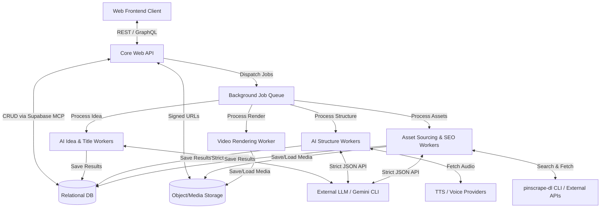

# System Architecture Specification

## 1. High-Level Architecture Overview

Video Worker Studio follows a modern, serverless-first hybrid architecture, utilizing a monolithic web API backend for data and orchestration, and distributed background workers for intensive tasks (AI generation, asset fetching, and video rendering). 

The system acts as the "Manager" for a set of specialized "Agents," ensuring that state is deterministically stored in the database and LLMs only interact through structured inputs and outputs.

**Key Components:**
1.  **Client Application (Frontend):** A web-based SPA where creators input ideas, review generated structures, select assets, and view rendered videos.
2.  **Core Web API (Backend):** The central nervous system. Handles authentication, database interactions, CRUD operations for video projects, routing, and user state.
3.  **Job Orchestration Queue:** An asynchronous execution layer. Takes heavy AI and rendering workloads away from the Core API.
4.  **AI Agents (Workers):** Specialized background processes that execute specific cognitive tasks (e.g., Idea Enhancement, Asset Query Generation) using external LLMs with strict JSON schema constraints.
5.  **Renderer (Worker):** A deterministic system that compiles images, text, transitions, and audio into an MP4 video file.
6.  **Object Storage:** Cloud-based storage for user-uploaded media, cached internet assets, synthesized voice-over files, and final rendered videos.

---

## 2. Component Diagram

---

## 3. Data Flow: Typical Video Creation Pipeline

### Step A: Project Initiation
1. Frontend calls API with raw prompt.
2. API creates a project in DB, sets status to `Draft`.
3. API pushes "Idea Enhancement Job" to Queue.
4. API replies to Frontend with `Project ID`.

### Step B: AI Enhancement
1. Queue worker picks up Idea Enhancement Job.
2. Worker calls LLM API with prompt and strict JSON schema.
3. Worker receives JSON payload, writes data to DB, setting project state to `Idea Ready`.
4. Frontend polls (or receives WebSocket event) and displays enhanced options to user.

### Step C: User Confirmation & Structure Generation
1. User approves a concept; Frontend notifies API.
2. API pushes "Structure & Template Job" to Queue.
3. Worker calls LLM (or Gemini CLI) to generate scenes, fetching TTS audio if needed, saving results to DB.
4. API pushes "Asset Sourcing Job" to Queue to fetch assets via `pinscrape-dl` CLI based on generated queries.
5. Asset worker fetches previews, registers them in DB.
6. State becomes `Assets Ready / Awaiting User Review`.

### Step D: Preview & Final Render
1. User reviews the timeline on Frontend, edits captions, and changes assets (which makes synchronous CRUD calls to API).
2. User clicks Render. API pushes "Render Job" to local Queue, which hits Cloudflare tunnel webhooks (`webhook.topstm.com`) if needed.
3. Renderer uses AWS Lambda (`@remotion/lambda`) to render the MP4, uploads to Storage, and updates DB status.

---

## 4. Design Principles & Constraints

### 4.1 Strict State Determinism
LLMs **do not** write directly to the primary system state without validation. All AI worker responses go through rigorous schema validators (e.g., Zod) before being committed to the database.

### 4.2 Decoupled Rendering
The video renderer does not have agency. It accepts a strictly typed `RenderManifest` JSON file (describing timing, asset URLs, Ken Burns effects, and text overlays) and executes exactly what is ordered.

### 4.3 Pluggable "Specialized Agents"
Agents are modeled as independent functions answering to Queue jobs. This allows us to easily swap out OpenAI for Anthropic, or change how the Idea Enhancer evaluates things without affecting the core API or the Renderer.

### 4.4 Resilient Retries
All Queue Jobs must be idempotent. If an asset fetching job fails midway due to a timeout from Pinterest, it must be safely restartable without duplicating data in the database.
